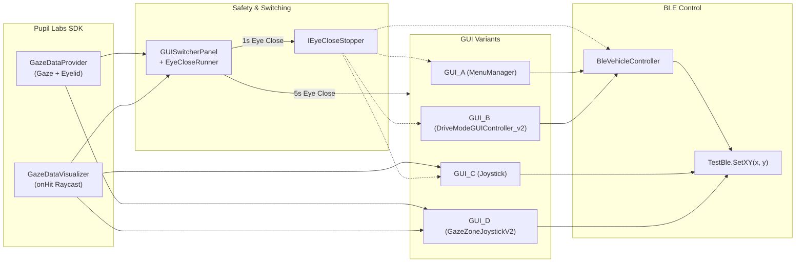

# `Assets/kristof` — Eye-Tracking & BLE Wheelchair Control (Unity / MRTK / Pupil Labs)

This folder contains the core scenes, scripts, prefabs, and assets for controlling a powered wheelchair or mobile platform using **eye gaze** and **eyelid closure** via **Pupil Labs (Neon / XR)** and **Mixed Reality Toolkit (MRTK)**, transmitting movement commands over **Bluetooth Low Energy (BLE)**.

Control commands are transmitted as 2D byte coordinates `(X, Y)` in the range `0–255`, where **`(128, 128)` represents the neutral (STOP) position**.

---

## Table of Contents

1. [Directory Structure](#directory-structure)
2. [How the Control Interfaces (GUIs) Work](#how-the-control-interfaces-guis-work)
   - [GUI_A — Classic Submenu Button Control](#gui_a--classic-submenu-button-control)
   - [GUI_B — State-Driven Drive Mode & Dynamic Turning](#gui_b--state-driven-drive-mode--dynamic-turning)
   - [GUI_C — Continuous Gaze Joystick](#gui_c--continuous-gaze-joystick)
   - [GUI_D — Incremental Gaze-Zone Joystick](#gui_d--incremental-gaze-zone-joystick)
3. [Core Architecture, Safety & Code Interfaces](#core-architecture-safety--code-interfaces)
   - [`IEyeCloseStopper` Interface](#ieyeclosestopper-interface)
   - [`GUISwitcherPanel` & Two-Stage Eye-Close Detection](#guiswitcherpanel--two-stage-eye-close-detection)
   - [`BleVehicleController` & BLE Protocol](#blevehiclecontroller--ble-protocol)
4. [Detailed Script Reference](#detailed-script-reference)
5. [Project Setup & Unity Configuration](#project-setup--unity-configuration)
6. [Testing Without an Eye Tracker (`testMode`)](#testing-without-an-eye-tracker-testmode)
7. [Important Notes & Troubleshooting](#important-notes--troubleshooting)
8. [License](#license)

---

## Directory Structure

```text
Assets/kristof/
├── Scenes/                  # Unity scenes for boot, UI switching, and calibration
├── Scripts/                 # C# scripts for UI logic, gaze processing, and BLE control
├── Prefabs/                 # Pre-configured UI variants (GUI_A to GUI_D) and visual elements
├── Material/                # Custom MRTK backplate materials and UI textures/icons
├── diagramy/                # Architecture, sequence, and class diagrams (Mermaid Markdown)
└── Testing_Data/            # Experimental metrics and User Experience Questionnaire (UEQ) data
```

### 1. `Scenes/`
- **`BootScene.unity`**: The main entry scene containing the initialization setup, `GUISwitcherPanel`, BLE references, and the four controllable GUI variants.
- **`PL_Calibration_Short.unity`**: A streamlined Pupil Labs calibration scene for quick eye-tracker calibration.

### 2. `Scripts/`
Contains all C# scripts powering the four GUI variants, safety stop mechanisms, and BLE command translation (see [Detailed Script Reference](#detailed-script-reference) below).

### 3. `Prefabs/`
- **`GUI_A 1.prefab`**: Prefab for Variant A (Directional buttons + locked submenus).
- **`GUI_B.prefab` / `GUI_B 1.prefab`**: Prefab for Variant B (Drive Mode state machine with dynamic turning).
- **`GUI_C 1.prefab`**: Prefab for Variant C (Continuous gaze-following virtual joystick).
- **`GUI_D 1.prefab`**: Prefab for Variant D (Zone-based incremental joystick with arrow stacks).
- **`ArrowPrefab.prefab` & `ArrowHead.prefab`**: Visual arrow indicators used by `ArrowStackUI` in `GUI_D`.
- **`Icon_RadioFill_F.png`**: UI icon asset used in button templates.

### 4. `Material/`
- Custom **MRTK Backplate gradient materials** (`MRTK_Backplate_10mm_Gradient_*.mat`, `MRTK_Backplate_round_Gradient.mat`) used to visually distinguish button states (normal, active/highlighted, idle turn, active turn, stop).
- **`ArrowHead.png` & `CenterPoint.png`**: Textures for the joystick crosshair, center point, and directional arrows.

### 5. `diagramy/`
Mermaid architecture documentation illustrating how hardware, Pupil Labs SDK, MRTK, and the custom scripts interact:
- `01-komponentovy-diagram.md`: High-level system architecture flowchart.
- `02-sekvencny-hlavny-tok.md`: Sequence diagram of the main gaze-to-BLE control flow.
- `03-sekvencny-eye-close-stop.md`: Sequence diagram of the emergency eye-close STOP mechanism.
- `04-sekvencny-prepinanie-gui.md`: Sequence diagram of switching GUIs via `GUISwitcherPanel`.
- `05-class-diagram.md`: Class diagram of all C# scripts and their relationships.

### 6. `Testing_Data/`
- Contains evaluation datasets from user testing (`experiment_metrics_final.csv` and `UEQ_GUI_A.xlsx` through `UEQ_GUI_D.xlsx`).

---

## How the Control Interfaces (GUIs) Work

The project implements **four distinct user interface paradigms (`GUI_A` – `GUI_D`)** divided into two primary UX branches: **Button/Submenu Discrete Control (`GUI_A`, `GUI_B`)** and **Joystick Gaze Control (`GUI_C`, `GUI_D`)**.

| GUI Variant | Control Paradigm | Primary Scripts | BLE Output Method |
| :--- | :--- | :--- | :--- |
| **`GUI_A`** | Discrete Buttons + Submenu Locking | `MenuManager`, `BleVehicleController` | Via `BleVehicleController` → `TestBle` |
| **`GUI_B`** | State-Driven Drive Mode + Dynamic Turning | `DriveModeGUIController_v2`, `SubmenuAutoHide`, `ButtonHighlightManager`, `BleVehicleController` | Via `BleVehicleController` → `TestBle` |
| **`GUI_C`** | Continuous Gaze-Following Joystick | `Joystick` (or `BLE`) | Direct proportional `(X, Y)` → `TestBle` |
| **`GUI_D`** | Incremental Gaze-Zone Joystick | `GazeZoneJoystickV2`, `ArrowStackUI` | Direct stepped `(X, Y)` → `TestBle` |

---

### `GUI_A` — Classic Submenu Button Control
- **Concept**: Uses main directional buttons (`Up`, `Down`, `Left`, `Right`, `Stop`) that expand into speed submenus (`Slow` / `Fast`) when looked at.
- **How it works (`MenuManager` + `BleVehicleController`)**:
  1. Looking at a primary direction calls `ShowSubMenu(...)`, revealing its `Slow` and `Fast` option buttons.
  2. Looking away hides the submenu **unless** a command inside that submenu is currently active (`lockedSubMenu`).
  3. Selecting a speed option triggers `BleVehicleController` (e.g., `DriveForwardSlow()`), locks that submenu open so the user always sees their active state, and swaps the selected button's material to `activeMaterial`.
  4. Triggering `STOP` (via button or closing eyes) calls `ResetAllVisuals()` and stops the wheelchair.

### `GUI_B` — State-Driven Drive Mode & Dynamic Turning
- **Concept**: A context-aware UI state machine designed for smooth driving. Instead of stopping to turn, the user can steer dynamically while driving forward or backward.
- **How it works (`DriveModeGUIController_v2` + `SubmenuAutoHide` + `ButtonHighlightManager` + `BleVehicleController`)**:
  1. **Idle & Speed Selection**: Looking at `Up`, `Down`, `Left`, or `Right` opens the corresponding `SubmenuAutoHide` panel with a 3-second auto-hide timer.
  2. **Pinning & Driving**: Selecting `Slow` or `Fast` pins the submenu open (`PinSelected()`), highlights the chosen speed via `ButtonHighlightManager`, and transitions the UI into `DrivingForward`, `DrivingBackward`, or `TurningInPlace`.
  3. **Dynamic Steering While Driving**: When driving forward or backward, stationary left/right buttons are replaced by `driveLeftButton` and `driveRightButton`. Looking at a drive-turn button invokes `BleVehicleController.StartTurnLeft()` / `StartTurnRight()`, which smoothly ramps up the horizontal `X` offset over `turnRampTime` while maintaining forward/backward `Y` speed. The button's material smoothly blends between `idleTurnMaterial` and `drivingTurnMaterial` to reflect turn intensity.
  4. **Two-Step Stop / Confirm**: Looking at the `Stop` button reveals a `Confirm` button (with a configurable `confirmTimeout`), preventing accidental stops from stray glances, or stops immediately upon confirmation/eye closure.

### `GUI_C` — Continuous Gaze Joystick
- **Concept**: A virtual 2D analog joystick where a pointer continuously follows the user's gaze raycast hit point on a collider plane.
- **How it works (`Joystick`)**:
  1. Subscribes to `GazeDataVisualizer.onHit`. When `FollowGaze` is active, the pointer moves to the local hit position (clamped to `maxDistance`).
  2. Every frame, `SendData()` normalizes the pointer's offset within `maxEffectiveDistance` and maps it continuously to BLE coordinates `X, Y` in the range `[58, 198]` centered around `(128, 128)`.
  3. **Safety Auto-Reset**: If gaze leaves the collider or exceeds `maxDistance` for longer than `outOfZoneResetTime` (default `1.0s`), `FollowGaze` disables and the pointer snaps back to neutral `(128, 128)`.

### `GUI_D` — Incremental Gaze-Zone Joystick
- **Concept**: A discrete, step-based virtual joystick controlled by briefly glancing at the outer edges of a tracking area, with visual feedback provided by stacked arrows.
- **How it works (`GazeZoneJoystickV2` + `ArrowStackUI`)**:
  1. The tracking area is divided into a central neutral area and 4 outer activation zones: `Left`, `Right`, `Up`, and `Down` (defined by `horizontalActivationEdge` and `verticalActivationEdge`).
  2. **Direct Zone Activation**: Fixating inside an edge zone for `activationFixationTime` (default `0.10s`) triggers a discrete step in that direction (`TriggerGesture()`).
  3. **Incremental Speed Levels**: Each direction has levels from `0` to `maxLevel` (default `3`, mapped to step offsets `{20, 40, 60}`). Triggering `Up` while moving backward first decrements `backwardLevel` toward `0` before incrementing `forwardLevel` (and vice versa for `Left`/`Right`).
  4. **Latching**: Once a zone triggers, it latches (`latchedZone`). To increment the level again, the user returns their gaze to the center (`Zone.None`) and glances back at the edge.
  5. **Visual Arrow Stacks**: `ArrowStackUI` displays `1` to `3` stacked arrows per direction corresponding to the active speed level.
  6. **Built-In Safety Stops**: Automatically resets all levels to `0` and sends `(128, 128)` if gaze is lost for `gazeLostStopDelay` (`0.2s`) or if eyes remain closed for `eyeCloseStopTime` (`0.25s`).

---

## Core Architecture, Safety & Code Interfaces



### `IEyeCloseStopper` Interface
Defined in [`Scripts/IEyeCloseStopper.cs`](Scripts/IEyeCloseStopper.cs):
```csharp
public interface IEyeCloseStopper
{
    void EyeCloseStop();
}
```
- **Purpose**: Provides a unified contract so any active control interface can execute an immediate emergency stop and reset its UI state when the user closes their eyes.
- **Implementations**:
  - `MenuManager.EyeCloseStop()`: Resets button materials, unlocks submenus, and hides all submenus.
  - `DriveModeGUIController_v2.EyeCloseStop()`: Calls `OnStop()`, halting the vehicle, clearing button highlights, and returning to `Mode.Idle`.
  - `BleVehicleController.EyeCloseStop()`: Calls `StopAll()`, resetting driving/turning flags and sending `(128, 128)` to `TestBle`.
  - `Joystick.EyeCloseStop()`: Disables `FollowGaze`, centers the pointer, and sends `(128, 128)` to `TestBle`.

### `GUISwitcherPanel` & Two-Stage Eye-Close Detection
[`Scripts/GUISwitcherPanel.cs`](Scripts/GUISwitcherPanel.cs) manages both **switching between GUI variants** and **global eye-closure safety monitoring**:
1. **Persistent Background Monitoring (`EyeCloseRunner`)**: On startup, `GUISwitcherPanel` spawns a `DontDestroyOnLoad` helper object (`EyeCloseRunner`) that calls `TickEyeClose()` every frame—even when the switcher panel itself is hidden (`gameObject.SetActive(false)`).
2. **Stage 1 — Emergency STOP (`stopAfterSeconds`, default `1.0s`)**:
   - Reads left + right eyelid aperture sum (`eyelidApertureLeft + eyelidApertureRight`) from `GazeDataProvider.Eyelid`.
   - When the sum drops below `eyeCloseThreshold` for `1.0s`, it finds the currently active `GUIOption`, queries all `IEyeCloseStopper` components on its `eyeCloseObject`, and invokes `EyeCloseStop()`. If none are found, it falls back to `bleVehicleController.StopAll()`.
3. **Stage 2 — Open GUI Switcher (`switchAfterSeconds`, default `5.0s`)**:
   - If the user keeps their eyes closed for `5.0s`, `OpenSwitcher()` deactivates all GUI variants and displays the `GUISwitcherPanel`.
   - The user can then look at any option's `gazeButton` for `activationTime` (`1.5s`) to activate the selected GUI and hide the switcher.

### `BleVehicleController` & BLE Protocol
- **BLE Coordinate Convention**:
  - `X` axis: Left (`< 128`), Neutral (`128`), Right (`> 128`)
  - `Y` axis: Backward (`< 128`), Neutral (`128`), Forward (`> 128`)
- **`BleVehicleController`** acts as a high-level wrapper over `TestBle` for button-based GUIs (`GUI_A` and `GUI_B`):
  - Exposes discrete methods for Unity Events: `DriveForwardSlow()`, `DriveForwardFast()`, `DriveBackwardSlow()`, `DriveBackwardFast()`, `DriveLeftSlow()`, `DriveLeftFast()`, `DriveRightSlow()`, `DriveRightFast()`, and `StopAll()`.
  - Handles smooth dynamic steering during forward/backward motion via `StartTurnLeft()`, `StartTurnRight()`, and `StopTurn()`, interpolating `currentX` toward `128 ± maxTurnOffset` over `turnRampTime`.

---

## Detailed Script Reference

| Script | Namespace | Role & Description |
| :--- | :--- | :--- |
| [`IEyeCloseStopper.cs`](Scripts/IEyeCloseStopper.cs) | Global | Interface with `void EyeCloseStop()` for unified eye-close emergency stopping. |
| [`GUISwitcherPanel.cs`](Scripts/GUISwitcherPanel.cs) | Global | Manages GUI variant switching via gaze fixation and runs two-stage eye-closure detection (`STOP` after 1s, `OpenSwitcher` after 5s) via `EyeCloseRunner`. |
| [`BleVehicleController.cs`](Scripts/BleVehicleController.cs) | Global | High-level movement controller wrapping `TestBle`. Supports slow/fast directional presets and time-ramped dynamic turning while driving. |
| [`MenuManager.cs`](Scripts/MenuManager.cs) | Global | Controller for `GUI_A`. Manages directional submenus, locks the active command's submenu open, and highlights active MRTK buttons. |
| [`DriveModeGUIController_v2.cs`](Scripts/DriveModeGUIController_v2.cs) | Global | State machine for `GUI_B`. Coordinates speed submenus, forward/backward driving states, dynamic turn buttons with `Material.Lerp` visual feedback, and Stop/Confirm timeouts. |
| [`SubmenuAutoHide.cs`](Scripts/SubmenuAutoHide.cs) | Global | Manages `Slow`/`Fast` submenu visibility in `GUI_B` with an auto-hide timer (`timeout = 3s`) and a pinned state (`PinSelected()`) when a speed is active. |
| [`ButtonHighlightManager.cs`](Scripts/ButtonHighlightManager.cs) | Global | Swaps MRTK button backplate materials between `normalMaterial` and `activeMaterial` in `GUI_B`. |
| [`Joystick.cs`](Scripts/Joystick.cs) | `PupilLabs` | Controller for `GUI_C`. Continuous gaze-following joystick with `outOfZoneResetTime` safety reset and `IEyeCloseStopper` support. |
| [`BLE.cs`](Scripts/BLE.cs) | `PupilLabs` | Simpler prototype version of the continuous gaze-following pointer-to-BLE mapper (immediately stops following if raycast misses). |
| [`GazeZoneJoystickV2.cs`](Scripts/GazeZoneJoystickV2.cs) | `PupilLabs` | Controller for `GUI_D`. Zone-based incremental joystick with configurable step arrays per direction, diagonal speed compensation, gaze-loss stop, and eye-close stop. |
| [`ArrowStackUI.cs`](Scripts/ArrowStackUI.cs) | Global | Instantiates and manages a stack of arrow prefabs with position offset and scale falloff to visualize speed levels (`0..maxLevel`) in `GUI_D`. |

---

## Project Setup & Unity Configuration

### 1. External Scene Prerequisites
Before using the prefabs or scripts in a scene, ensure the Unity project/scene contains:
1. **Pupil Labs XR / Neon Package**:
   - A `ServiceLocator` instance in the scene with child components `GazeDataVisualizer` (emitting `onHit(Vector3)` raycast events) and `GazeDataProvider` (providing gaze rays and `Eyelid` aperture data).
2. **BLE Communication Component (`TestBle`)**:
   - An active `TestBle` component in the scene (located outside `Assets/kristof`) exposing `SetXY(int x, int y)` (or `SetXY(byte x, byte y)`).
3. **MRTKv3 Setup**:
   - MRTK XR Rig with eye-gaze interactor (`FuzzyGazeInteractor`) for `PressableButton` dwell events used in `GUI_A` and `GUI_B`.

### 2. Setting Up the `GUISwitcherPanel`
1. Place the `GUISwitcherPanel` object in your scene (already configured in `BootScene.unity`).
2. In the Inspector, populate the **`Options`** list (`List<GUIOption>`) for each GUI variant (`GUI_A` to `GUI_D`):
   - **`Gaze Button`**: The collider button inside the switcher UI that the user looks at to select this GUI.
   - **`Gui Object`**: The root `GameObject` of the GUI prefab in the scene.
   - **`Eye Close Object`**: The `GameObject` carrying the `IEyeCloseStopper` script(s) for that GUI (e.g., the object with `MenuManager`, `DriveModeGUIController_v2`, or `Joystick`).
3. Assign `Ble Vehicle Controller` and `TestBle` references, and tune `stopAfterSeconds` (default `1s`) and `switchAfterSeconds` (default `5s`).

### 3. Setting Up `GUI_B` (Drive Mode UI)
- Attach `DriveModeGUIController_v2` and wire the following Inspector references:
  - **Controllers**: `BleVehicleController` (`vehicle`) and `ButtonHighlightManager` (`highlight`).
  - **Submenu Controllers**: Assign the four `SubmenuAutoHide` components (`forwardSubmenu`, `leftSubmenu`, `rightSubmenu`, `backwardSubmenu`), each linked to its respective `slowButton` and `fastButton`.
  - **Buttons**: Link main directional buttons (`upButton`, `downButton`, `leftButton`, `rightButton`), `stopButtonForward`/`Backward`, `confirmButtonForward`/`Backward`, speed buttons, and `driveLeftButton`/`driveRightButton`.
  - **Materials**: Assign `idleTurnMaterial` and `drivingTurnMaterial` (ideally using the same shader so `Material.Lerp` works smoothly).

### 4. Setting Up `GUI_D` (Gaze-Zone Joystick)
- On the `GazeZoneJoystickV2` component:
  - Assign **`Pointer`** (`Transform` that moves across the tracking collider) and **`Ble`** (`TestBle`).
  - Assign the four **`ArrowStackUI`** references (`forwardArrows`, `backwardArrows`, `leftArrows`, `rightArrows`), and ensure each `ArrowStackUI` has `ArrowPrefab` assigned.
  - Ensure the tracking surface has a `Collider` so `GazeDataVisualizer` can register raycast hits on it.

---

## Testing Without an Eye Tracker (`testMode`)

Both `GUISwitcherPanel` and `GazeZoneJoystickV2` include a built-in **`testMode`** for debugging in the Unity Editor without Pupil Labs hardware connected:

1. Enable the **`Test Mode`** checkbox in the Inspector on `GUISwitcherPanel` and/or `GazeZoneJoystickV2`.
2. When `testMode` is enabled:
   - `GazeDataProvider` is not required for eyelid aperture readings.
   - Open eyes are simulated with `simulatedOpenEyesValue` (`20.0`).
   - Holding down the **`B` key** (configurable via `simulatedEyeCloseKey`) simulates closed eyes (`simulatedClosedEyesValue = 0.0`), triggering the 1-second emergency `STOP` and 5-second `GUISwitcherPanel` activation.
3. In `GazeZoneJoystickV2`, you can also assign a TextMeshPro UI label to **`Eyelid Sum Text`** (`eyelidSumText`) to view live eyelid aperture values, active thresholds, and `testMode` status on screen.

---

## Important Notes & Troubleshooting

- **`TestBle` Dependency**: All scripts expect a `TestBle` class with a `SetXY(x, y)` method. This script is located in the main project outside `Assets/kristof`.
- **Automatic Component Disabling**: If `ServiceLocator`, `GazeDataVisualizer`, `GazeDataProvider` (when `testMode == false`), or `TestBle` are missing at `Start()`, `GazeZoneJoystickV2` and `GUISwitcherPanel` log an error and disable themselves (`enabled = false`).
- **MRTK Button Renderer Hierarchy**: `MenuManager`, `ButtonHighlightManager`, and `DriveModeGUIController_v2` locate button `Renderer` components for material swapping using standard MRTK button paths:
  1. Primary path: `UIBackplateOuterGeometry/UX.Button.BackplateOuterGeometry`
  2. Fallback path: `CompressibleButtonVisuals/FrontPlate`
  If you create custom button prefabs, maintain one of these child paths so material highlighting works as expected.

---

## License

The contents of `Assets/kristof` are licensed under the **BSD 3-Clause License**.
